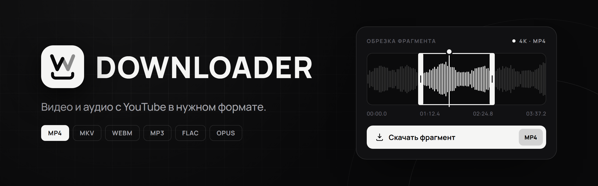

<div align="center">

<picture>
  <source media="(prefers-color-scheme: dark)" srcset=".github/assets/banner-dark.png" />
  <source media="(prefers-color-scheme: light)" srcset=".github/assets/banner-light.png" />
  
</picture>

<br />
<br />

Строгий монохромный интерфейс, встроенный плеер и обрезка до скачивания.

<br />


<br />

[**Скачать**](https://github.com/sosulacka/WDownloader/releases) &nbsp;·&nbsp;
[Возможности](#возможности) &nbsp;·&nbsp;
[Установщик](#установщик) &nbsp;·&nbsp;
[Сборка](#сборка-из-исходников) &nbsp;·&nbsp;
[Лицензия](#лицензия)

</div>

<br />

## Возможности

<table>
<tr>
<td width="50%" valign="top">

### Скачивание
- Обычные видео, Shorts, ссылки `youtu.be` и записи завершённых трансляций
- Название, автор, превью, длительность и реальные разрешения до скачивания
- Верхняя граница качества вплоть до 8K, битрейт аудио от 128 до 320 кбит/с
- Очередь до 50 задач: скорость, оставшееся время, отмена и повтор
- Продолжение прерванных загрузок, готовые файлы не перезаписываются

</td>
<td width="50%" valign="top">

### Плеер и обрезка
- Встроенный видео- и аудиоплеер с настоящей звуковой волной
- Громкость, скорость от 0.5× до 2×, повтор фрагмента, полный экран
- Обрезка двумя границами: перетаскивание, клик или точный ввод времени
- Сохраняется только выделенный кусок, срез точный до десятой секунды
- Готовые загрузки открываются в том же плеере

</td>
</tr>
<tr>
<td width="50%" valign="top">

### Интерфейс
- Чёрная, белая и системная тема
- Смена темы расходится кругом от кнопки
- Иконки [Keyline](https://github.com/keyline-icons/keyline-icons) в четырёх стилях и трёх толщинах
- Плавные анимации, которые можно выключить
- Русский и английский язык, переключатель RU / EN

</td>
<td width="50%" valign="top">

### Удобство
- `Ctrl` + `L` сразу ставит курсор в поле ссылки
- История с поиском и фильтрами по типу файла
- Метаданные: название, автор и главы
- Свой титлбар и окно без системной рамки
- yt-dlp, FFmpeg и Deno ставятся сами при первом запуске

</td>
</tr>
</table>

### Форматы

| | Форматы | Примечание |
|---|---|---|
| **Видео** | `MP4` `MKV` `WebM` `MOV` | MP4 и MOV собираются из MP4 + M4A, MKV берёт лучшее сочетание |
| **Аудио** | `MP3` `M4A` `WAV` `FLAC` `Opus` `AAC` `OGG` | FLAC и WAV не восстанавливают качество сжатого источника |

<br />

## Установщик

У Wdownloader свой установщик на Rust и Tauri в том же стиле, что и приложение. Права администратора не нужны.

| Файл | Размер | Что внутри |
|---|---|---|
| `Wdownloader-0.1.0-setup.exe` | ~11 МБ | Только приложение. Компоненты скачаются при первом запуске |
| `Wdownloader-0.1.0-offline-setup.exe` | ~193 МБ | Приложение, yt-dlp, FFmpeg и Deno. Интернет при установке не нужен |

GitHub Actions собирает обе версии установщика. В релизах доступны мини-версия и офлайн-версия с компонентами внутри.

**Что делает установщик**

- Ставит приложение в `%LOCALAPPDATA%\Programs\Wdownloader`, папку можно поменять
- Создаёт ярлык в меню Пуск и, по желанию, на рабочем столе
- Добавляет Wdownloader в список установленных приложений Windows
- Обновляет поверх старой версии, настройки и история сохраняются
- Удаляется через `uninstall.exe` или параметры Windows, скачанные файлы остаются на месте
- Тоже умеет чёрную и белую тему, русский и английский язык

> [!NOTE]
> Бинарники и установщик не подписаны цифровой подписью, поэтому при первом запуске Windows SmartScreen может показать предупреждение.

<br />

## Сборка из исходников

### Что понадобится

| | Версия |
|---|---|
| [Node.js](https://nodejs.org) | 22.12 или новее |
| [Rust](https://rustup.rs) | stable |
| Microsoft C++ Build Tools | с компонентом "Desktop development with C++" |
| WebView2 | уже есть в Windows 10 и 11 |

Подробнее в [требованиях Tauri](https://v2.tauri.app/start/prerequisites/).

### Запуск

```powershell
git clone https://github.com/sosulacka/WDownloader.git
cd WDownloader
npm ci
npm run desktop
```

### Команды

| Команда | Что делает |
|---|---|
| `npm run desktop` | Запускает приложение в режиме разработки |
| `npm run dev` | Открывает интерфейс в браузере, без скачивания |
| `npm run build` | Проверяет TypeScript и собирает фронтенд |
| `npm run setup:tools` | Скачивает yt-dlp, FFmpeg и Deno в `tools/` |
| `npm run setup:build` | Собирает оба установщика в `dist-installer/` |
| `npm test` | Тесты фронтенда |
| `cargo test --manifest-path src-tauri/Cargo.toml` | Тесты Rust |

> [!TIP]
> Для офлайн-установщика сначала выполните `npm run setup:tools`. Без компонентов в `tools/` собирается только лёгкая версия.

<br />

## Как устроено

```
Wdownloader/
├── src/                 Интерфейс: Astro + React
│   ├── components/      Экраны, плеер, панель загрузки, настройки
│   ├── lib/             Темы, язык, таймкоды, типы
│   └── styles/parts/    Стили по разделам, цвета через CSS-переменные
├── src-tauri/           Приложение на Rust: загрузки, предпросмотр, компоненты
├── installer/           Свой установщик на Rust + Tauri
│   ├── src/             Установка, удаление, ярлыки, реестр, упаковка
│   └── ui/              Окно установщика
├── scripts/             Сборка установщиков и подготовка компонентов
└── tests/               Тесты
```

<details>
<summary><b>Подробнее о работе приложения</b></summary>

<br />

Интерфейс общается с Rust через команды и события Tauri. Rust проверяет ссылку и параметры, запускает yt-dlp без shell, читает его вывод и отправляет прогресс в интерфейс. yt-dlp вызывает FFmpeg для объединения дорожек и конвертации. Deno нужен yt-dlp для обработки JavaScript YouTube.

Прогресс относится к текущей дорожке: сначала скачивается видео, затем звук, затем они объединяются. Для точной обрезки выполняется перекодирование.

Предпросмотр готовит облегчённую локальную копию по кнопке. Для аудио строится настоящая звуковая волна, видео приводится к H264/AAC до 480p. Копии хранятся в кэше приложения.

Компоненты ставятся в `%LOCALAPPDATA%\com.wdownloader.desktop\tools\`. Ещё они ищутся рядом с приложением, в `tools/` проекта и в `PATH`. Загрузка идёт с официальных GitHub-репозиториев с таймаутом, архивы распаковываются во временную папку, каждый бинарник проверяется запуском, yt-dlp дополнительно по SHA256. Если установка не удалась, приложение покажет причину, кнопку повтора и инструкцию для ручной установки.

</details>

<details>
<summary><b>Ограничения</b></summary>

<br />

- Плейлисты и прямые трансляции пока не поддерживаются
- Разрешение ограничивает качество сверху и не увеличивает исходное видео
- YouTube может ограничивать выдачу по IP, региону или просить вход. Импорта cookies в этой версии нет
- Если скачивание перестало работать, обновите компоненты через `npm run setup:tools`
- В браузере работает только предпросмотр интерфейса, скачивание доступно в приложении

</details>

<br />

## Лицензия

Wdownloader распространяется по лицензии [GPL-3.0](LICENSE).

Приложение использует внешние инструменты со своими лицензиями: [yt-dlp](https://github.com/yt-dlp/yt-dlp), [FFmpeg](https://github.com/yt-dlp/FFmpeg-Builds) и [Deno](https://github.com/denoland/deno). У GPL-сборки FFmpeg есть требования к распространению исходников. Ссылки на проекты собраны в `tools/THIRD-PARTY.txt`, но перед публичным релизом нужен полный комплект лицензий.

<br />

<div align="center">

<sub>Сделано <a href="https://wteam.su"><b>WTEAM</b></a> · Разработчик CYN</sub>

</div>
